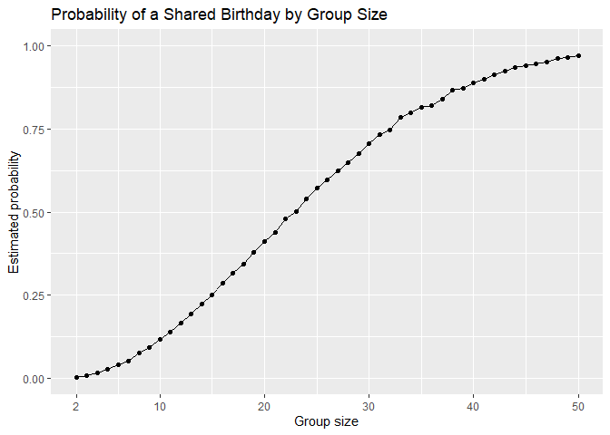
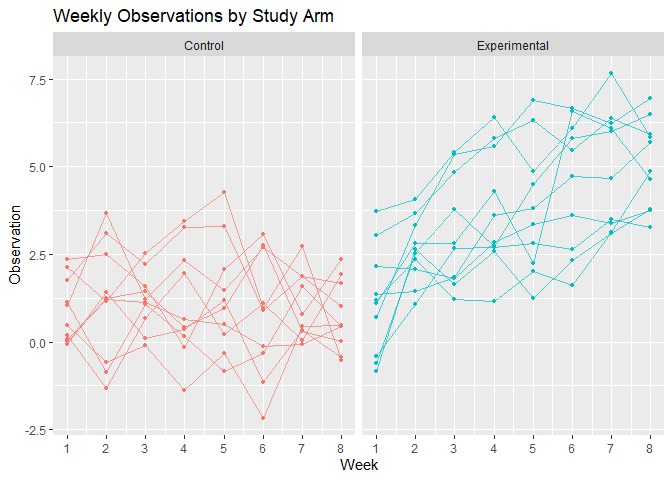

P8105 Homework 5
================
Zhenghong Chen zc2959
2026-11-18

# Problem 1

I wrote a function to simulate birthdays for a group of people and check
whether at least two people share the same birthday. Each birthday is
randomly sampled from 365 possible days with replacement. The function
returns TRUE if there is a shared birthday and FALSE otherwise.

``` r
birthday_match = function(group_size) {
  birthdays = sample(1:365, group_size, replace = TRUE)
  n_distinct(birthdays) < group_size
}
```

## Running the simulations

I ran the function 10,000 times for each group size from 2 to 50 and
recorded whether a shared birthday occurred in each simulation.

``` r
birthday_sim_df = 
  expand_grid( group_size = 2:50, iteration = 1:10000 ) |>
  mutate( shared_birthday = map_lgl(group_size, birthday_match) )
```

## Estimating the probabilities

For each group size, I estimated the probability of a shared birthday by
taking the mean of the simulation results. Since TRUE is treated as 1
and FALSE as 0, the mean gives the proportion of simulations with a
shared birthday.

``` r
birthday_prob_df = 
  birthday_sim_df |>
  group_by(group_size) |>
  summarize( probability = mean(shared_birthday) )

birthday_prob_df |>
  filter(group_size %in% c(2, 10, 23, 30, 40, 50)) |>
  knitr::kable(digits = 3)
```

| group_size | probability |
|-----------:|------------:|
|          2 |       0.002 |
|         10 |       0.116 |
|         23 |       0.502 |
|         30 |       0.705 |
|         40 |       0.888 |
|         50 |       0.972 |

## Plotting the probabilities

The following plot shows how the estimated probability of a shared
birthday changes with group size.

``` r
birthday_prob_df |>
  ggplot(aes(x = group_size, y = probability)) +
  geom_line() +
  geom_point(size = 1.5) + labs( title = "Probability of a Shared Birthday by Group Size", x = "Group size", y = "Estimated probability" ) +
  scale_x_continuous( breaks = c(2, 10, 20, 30, 40, 50) ) + 
  scale_y_continuous( breaks = c(0, .25, .5, .75, 1), limits = c(0, 1) )
```

<!-- -->

## Results

The estimated probability of a shared birthday increases as the group
size grows. For a group of 23 people, the estimated probability is
50.2%, while for a group of 50 people, it increases to 97.2%. The
probability reaches approximately 50% with only 23 people, which is
surprising given that there are 365 possible birthdays.

# Problem 2

## Importing the data

I first listed all the participant files and used `map()` to read each
file into a list column.

``` r
participant_files_df =
  tibble( file_name = list.files("./data", pattern = "^con_|^exp_") ) |>
  mutate( subject_data = purrr::map( file_name, \(file) read_csv(str_c("./data/", file)) ) )
```

## Tidying the data

I used the file names to get the study arm and subject ID. Then I
combined the files and reshaped the weekly measurements so that each row
represents one subject in one week.

``` r
study_tidy_df =
  participant_files_df |>
  separate(
    file_name,
    into = c("arm", "subject_id"),
    sep = "_"
  ) |>
  mutate(
    arm = str_replace(arm, "con", "Control"),
    arm = str_replace(arm, "exp", "Experimental"),
    subject_id = str_replace(subject_id, "\\(2\\)", ""),
    subject_id = str_replace(subject_id, "\\.csv$", "")
  ) |>
  unnest(cols = "subject_data") |>
  pivot_longer(
    week_1:week_8,
    names_to = "week",
    values_to = "observation"
  ) |>
  mutate(
    week = as.numeric(str_replace(week, "week_", ""))
  ) |>
  select(arm, subject_id, week, observation) |>
  arrange(arm, subject_id, week)

study_tidy_df |>
  group_by(arm) |>
  summarize(
    n_subjects = n_distinct(subject_id),
    n_observations = n()
  ) |>
  knitr::kable()
```

| arm          | n_subjects | n_observations |
|:-------------|-----------:|---------------:|
| Control      |         10 |             80 |
| Experimental |         10 |             80 |

## Spaghetti plot

I plotted each subject’s measurements over the eight weeks and separated
the two study arms to compare their patterns.

``` r
study_tidy_df |>
  ggplot(
    aes(
      x = week,
      y = observation,
      group = subject_id,
      color = arm
    )
  ) +
  geom_line(alpha = .7) +
  geom_point(size = 1) +
  facet_grid(. ~ arm) +
  labs(
    title = "Weekly Observations by Study Arm",
    x = "Week",
    y = "Observation"
  ) +
  scale_x_continuous(breaks = 1:8) +
  theme(legend.position = "none")
```

<!-- -->

# Problem 3
